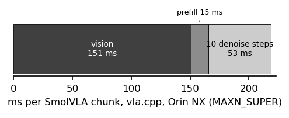
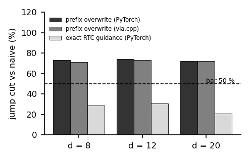
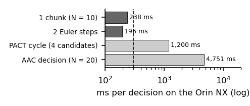

# Vision is the bottleneck: what transfers to the edge when a VLA runs on a Jetson Orin NX

*Draft, 4-page workshop version (WS-076, 2026-10-31). Rendered by `make_paper.py` from the result files: every number
below is a placeholder filled from `numbers.json`, which records each value's anchor. Nothing new was run.*

## Abstract

Training-free tricks promise faster or smoother execution of flow-matching vision-language-action policies, and they
are measured on desktop GPUs. On a Jetson Orin NX, a 450M SmolVLA spends {{glat_vision}} of {{glat_total}} ms of
server time per action chunk in its vision encoder ({{glat_vision_pct}} %, at 25 W). We measured seven of these tricks with one
checkpoint, the same 20 recorded episodes and bars committed before each run. A gradient-free prefix overwrite cuts the
boundary jump by {{ow_cut_20}}–{{ow_cut_12}} % for {{cpp_ow_added_ms}} ms per chunk; projecting each chunk onto ten
movement primitives with a via-point at the seam removes {{sm_seam25}}–{{sm_seam50}} % of the seam jerk at
{{sm_cost}}° of error. Two Euler steps instead of ten save {{n2_saved_ms}} ms (at MAXN) ({{n2_saved_pct}} %). Exact real-time
chunking costs {{exact_over_naive}}× a chunk; speculative selection (PACT) {{pact_ms}} ms per cycle, {{pact_d}} control
ticks instead of {{naive_d}}; entropy-adaptive chunking {{aac_n20_ms}} ms per decision. On the edge, overwrite the
prefix, smooth the seam, and leave the sampler alone.

## 1 Introduction

Robot-learning papers that speed up or smooth action chunking report their latencies on desktop and data-centre GPUs
(RTX 4090, A100, H100, RTX 5090), where a chunk costs tens of milliseconds and spare compute can hide an extra pass.
The robots people can buy run their policies on edge GPUs. We take one such setup — an SO-101 arm, a Jetson Orin NX
16 GB, SmolVLA through a C++ engine (vla.cpp) — and ask, for each trick, the question its paper does not: how much of
its benefit survives where the chunk is dominated by a cost the trick does not touch. Each answer is a pre-registered
gate: a bar committed before the number, an episode bootstrap for offline effects, medians of ≥ 50 calls for latency.

## 2 Where the time goes

A chunk at ten Euler steps costs {{n10_ms}} ms end to end on the Orin at full power (MAXN): {{vision_ms_a2}} ms of vision,
{{prefill_ms}} ms of prefill and {{step_ms}} ms per denoise step (Fig. 1; horizon × depth A2). At 25 W the server-side
split is {{glat_vision}} ms of vision in {{glat_total}} ms (G-lat-2, bar commit `{{bar_glat}}`). Any trick that only
touches the denoising loop works on at most a quarter of the chunk.

## 3 Seven tricks, one checkpoint

All offline effects use the same SmolVLA checkpoint and the same 20 recorded episodes (254 chunk boundaries per delay).

**Prefix overwrite vs exact real-time chunking (G13b).** Overwriting the new chunk's executed prefix with the
committed actions cuts the median boundary jump by {{ow_cut_8}} / {{ow_cut_12}} / {{ow_cut_20}} % at delays of
8 / 12 / 20 steps (bar ≥ 50 %); the exact guided inpainting of real-time chunking cuts it by {{ex_cut_8}} /
{{ex_cut_12}} / {{ex_cut_20}} % and costs {{pt_exact_ms}} ms per chunk in PyTorch against {{pt_naive_ms}} ms naive
({{exact_over_naive}}×). Ported to vla.cpp, the overwrite cuts {{cpp_cut_8}} / {{cpp_cut_12}} / {{cpp_cut_20}} % for
{{cpp_ow_added_ms}} ms per chunk (Fig. 2).

**Movement-primitive projection and seam conditioning (smooth chunking, bar commit `{{bar_sm}}`).** Projecting each
chunk onto ten Gaussian bases changes the error against the recorded continuation by {{sm_err}}° and removes
{{sm_jerk}} % of the within-chunk jerk; conditioning on the last action sent removes {{sm_seam25}} % (25-step overlap)
and {{sm_seam50}} % (sync) of the seam jerk at {{sm_cost}}°. Both pass their bars.

**Two Euler steps (horizon × depth, bar commit `{{bar_hd}}`).** Two steps contract the action cloud to
{{r2_ratio}} of its ten-step radius (CI {{r2_lo}}–{{r2_hi}}; bar ≤ 0.70, paper 0.51): {{r2_verdict}}. They save
{{n2_saved_ms}} ms per chunk ({{n2_ms}} vs {{n10_ms}} ms, ratio {{n2_over_n10}}).

**Speculative chunk selection (PACT-VLA, bar commit `{{bar_pact}}`).** Choosing among four candidates with the
pre-commit frame picks chunks closer to the recorded teleop continuation ({{pact_sel}}° against a random pick, CI
{{pact_sel_lo}} to {{pact_sel_hi}}; one recorded continuation per frame, training-set episodes, open loop), but vla.cpp samples sequentially: the cycle costs {{pact_ms}} ms against {{pact_tgen1}} ms,
{{pact_d}} control ticks against {{naive_d}}, so "no added control-step delay" fails.

**Entropy-adaptive chunk length (AAC, bar commit `{{bar_aac}}`).** The chosen length sits at its floor in both phases
(median {{aac_h_transport}} steps in transport and {{aac_h_grasp}} at the grasp), the median boundary-jump ratio with overwrite (the
step at the seam over the median step inside the chunk; lower is better) is {{aac_jump}} against {{aac_fixed_jump}} for fixed
chunks, and one decision with 20 samples costs {{aac_n20_ms}} ms
against a {{aac_bar_ms}} ms bar (Fig. 3).

## 4 The recipe, and what does not transfer

Turn on the prefix overwrite and the primitive projection with seam conditioning: both act on the seam, which the
vision cost does not hide, and both cost under a millisecond. Keep ten Euler steps, by the protocol's rule (the two-step
contraction is not proven) rather than because the saving is unreal: it is real but small because vision dominates. Do not sample several chunks per decision on a sequential edge engine: every N-sample
method (exact guidance, PACT, AAC) pays N chunks in series. Arm results for the three transferring tricks are
`[to run]` (smooth chunking gate B, horizon × depth gate B, the overwrite in the robot client); they are the whole
addition of the 8-page version.

## 5 Limitations

One policy (SmolVLA, 450M); π0-class models do not fit the Orin, which is itself part of the condition. vla.cpp is the
author's own port: it is measured against PyTorch on the same board (parity and determinism checks in the gate logs),
but an independent engine might move the sequential-sampling costs. Power mode is a confound: latency rows are at
MAXN_SUPER unless stated, the G13b and G-lat-2 rows at 25 W. One task family (bowls), offline episodes for every effect
except latency; no arm success column yet.

## References (ids from the papers mirror)

Real-time chunking 2506.07339 · Smooth MP chunking 2610.39451 · Horizon × depth 2610.32102 · PACT-VLA 2610.28019 ·
Adaptive action chunking 2604.04161 · SmolVLA 2506.01844 · TurboVLA 2607.27205 · RACE 2610.05719 · DREAM-Chunk 2606.18589 ·
ARLI 2608.23831 · VLA-Corrector 2609.06508.
