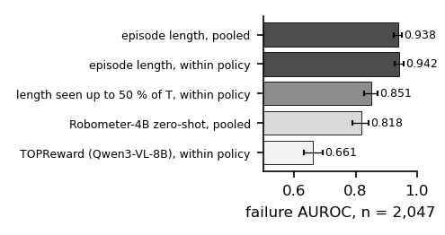
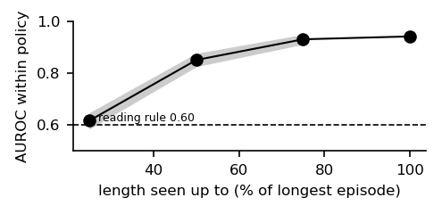
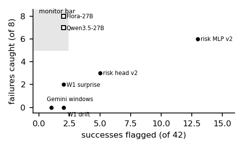

# What a reward model can show depends on who stopped the episode: failure judges and monitors on a low-cost arm

*Draft, 4-page workshop version (WS-077, 2026-10-31; WS-073's length paper is §3–4). Rendered by `make_paper.py` from the
result files; every number is a placeholder filled from `numbers.json`. Pre-registered analyses: `LENGTH_PROTOCOL.md`
(frozen `1a69f30`). Robometer under the within-policy and truncation analyses is pending its score files.*

## Abstract

Watching a robot run only up to half the length of the task's longest run, elapsed time already separates failed from
successful runs with AUROC 0.851 within policy (CI 0.829–0.873) on 2,047 public SO-101 rollouts from 7 policies: failed runs
are slow, not timed out (only 8.7 % reach the task's longest length). The dataset's stopping rule decides what a reward model
can show: where runs end at a time limit, elapsed time is the reward model to beat; where an operator stops them,
length is blind and a judge at rest works. Over the whole run, length gives 0.938 pooled and 0.942
within policy; two zero-shot reward models proposed as failure detectors score below it: Robometer-4B 0.818 pooled
(within policy pending) and TOPReward with an 8B video-language model 0.653 pooled, 0.661 within policy.
On 69 of our own operator-stopped rollouts length carries nothing (0.56), and TOPReward's
0.82 there is below what policy identity alone gives (0.87). A deterministic top-camera check at rest
makes no false positive; a robot-trained 27B judge separates every failure from every success (AUROC 1.00;
8 of 8 at 2 of 42 at a threshold chosen on the same episodes), and its base model does almost as well
given the same input; every mid-episode monitor we tested misses its bar. Report a length baseline, within policy, and
say who stopped the episodes.

## 1 Introduction

A reward model that scores robot rollouts is also a failure detector, and papers evaluate it as one. None of the
reward-model papers in our library reports how far plain episode length gets on the same data. We measure it on a
public SO-101 benchmark and on our own rollouts, with the analyses frozen before the numbers, and set every learned
judge and monitor we ran against it.

## 2 Data and labels

ArmnetBench v0.1 (SO-101, 8 tasks, 7 policies): 2,047 policy rollouts with a success or failure class
(515 successes, 1,532 failures); teleoperated episodes excluded. Our rollouts: 88 labelled bowls-task episodes
on one SO-101 and a Jetson Orin NX, and the 50-episode subset (42 successes, 8 failures) every monitor gate used. Labels
are the operator's, not blind to policy.

## 3 The length baseline

Pooled over policies, length gives 0.938 (CI 0.925–0.951); Robometer-4B, run zero-shot
as its authors ship it, 0.818 (CI 0.790–0.843; within policy pending its per-episode scores); TOPReward
(Qwen3-VL-8B, no training; the primary score, fixed in the protocol before any score, is the paper's success score, the sum
of its two standardised components) 0.653 pooled (CI 0.623–0.684) and 0.661
within policy (CI 0.631–0.692), below length by -0.31 to -0.25 (paired 95 % CI). Its full-video
Yes/No component alone, descriptive: 0.678 within policy. Within each policy, length ranges 0.91–0.96, pair-weighted
0.942 (CI 0.927–0.956): it is not the policy identity (Fig. 1).

## 4 Is it the timeout?

Only 8.7 % of failures run to the task's longest episode. Observing length only up to half of that, when
88 % of failures but 19 % of successes are still running, gives 0.851 within policy
(CI 0.829–0.873; Fig. 2; TOPReward on frames up to the same cut: 0.667): failed rollouts are slow, not timed out. Both pre-registered readings hold: length is a
within-policy null, and it is more than the timeout. On our own operator-stopped rollouts the same baseline is at chance
(0.56 on 69; 0.52 on all 88). Neither reward model beats the policy-identity null there:
TOPReward 0.82 (CI 0.70–0.93) against 0.87 for policy identity alone, and
0.78 on the 50 episodes without TurboVLA (17 of the 25 failures in the
69 come from TurboVLA); Robometer 0.577 against 0.878 on 88. The baseline depends on how
episodes end, which is why it must be reported per dataset; what works on operator-stopped runs is the judge at rest (§5).

## 5 Judges and monitors on our rollouts

**At rest.** A deterministic top-camera check (colour masks and geometry, no learning) is right on 94.3 % of
judged episodes with 0 false positives (Wilson 0–13 %) and 5 false negatives. Given a 64-frame
two-view clip and NVIDIA's prompt, Flora-Rewarder-27B separates every failure from every success (AUROC 1.00, the
threshold-free number); at its gate's operating point, a score threshold chosen on these same 50 episodes, it flags
8 / 8 failures at 2 / 42 successes (Wilson on the false alarms 1–16 %) and passes its bar; its base
model Qwen3.5-27B gets 7 / 8 at 2 / 42 on the same input at its own in-sample threshold; a 9B model (0.75) and Gemini 3.8 Flash (0.96, one false alarm over the
bar) do not pass. The input format, not the robot fine-tune, decided the result.

**Mid-episode.** A Gemini sliding-window judge catches 0 / 8; the surprise of a separate world model
2 / 8 (AUROC 0.86, Wilson 7–59 %); latent drift 0 / 8. An action-conditioned risk head on
the world model's latent reached 0.93 in a first version that read elapsed time; the pre-registered second version,
without time or length, catches 3 / 8 at 5 / 42 (AUROC 0.79 vs 0.71 with shuffled
actions; Wilson 14–69 %), and its MLP variant 6 / 8 at 13 / 42: **no monitor meets the bar**
(≥ 5 / 8 at ≤ 1 / 20), and the first version's result is withdrawn (Fig. 3).

## 6 Limitations

Two task families (ArmnetBench's eight tasks, our bowls task); our labels are the operator's and not blind; the risk
head is trained and tested on the same 50 episodes (5-fold by episode: episodes do not leak, tasks and policies do);
Robometer under the within-policy and truncation analyses is pending its per-episode scores; TOPReward's prefix
count, frames per query and Yes/No wording are not given in its paper and are ours; the operating points of Flora,
Qwen3.5-27B and Gemini are chosen in-sample on the 50 episodes they are scored on (their AUROCs are not); 17 of
the 25 failures in our 69 rollouts are TurboVLA's, so on our set any score that reads the policy gets the
identity null for free; the timeout is
approximated by each task's longest episode.

## References (ids from the papers mirror)

Robometer 2603.02115 · SARM 2509.25358 · TOPReward 2602.19313 · VLLR 2604.00055 · SARM2 2606.10305 · STDR 2606.31377 ·
No Free Checker 2609.09250 · FARM 2609.11445 · ReAP 2610.16309 · SAFE 2506.09937 · FAIL-Detect 2503.08558 ·
VLA-Corrector 2609.06508 · Spotter 2609.36808 · REMORA 2610.39125 · ArmnetBench 2607.24481 · SO-101 benchmark 2606.08881.
