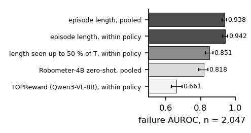
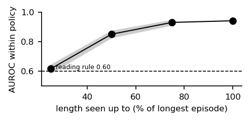
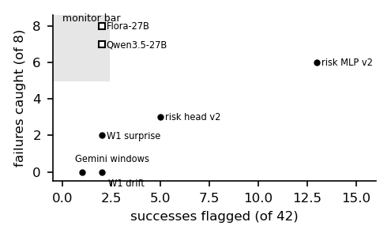

# What a reward model can show depends on who stopped the episode: failure judges and monitors on a low-cost arm

*Draft, 4-page workshop version (WS-077, 2026-10-31; WS-073's length paper is §3–4). Rendered by `make_paper.py` from the
result files; every number is a placeholder filled from `numbers.json`. Pre-registered analyses: `LENGTH_PROTOCOL.md`
(frozen `1a69f30`). Robometer under the within-policy and truncation analyses is pending its score files.*

## Abstract

Watching a robot run only up to half the length of the task's longest run, elapsed time already separates failed from
successful runs with AUROC {{t50_within}} within policy (CI {{t50_lo}}–{{t50_hi}}) on {{ab_n}} public SO-101 rollouts from {{n_pol}} policies: failed runs
are slow, not timed out (only {{hit_fail}} % reach the task's longest length). The dataset's stopping rule decides what a reward model
can show: where runs end at a time limit, elapsed time is the reward model to beat; where an operator stops them,
length is blind and a judge at rest works. Over the whole run, length gives {{len_pooled}} pooled and {{len_within}}
within policy; two zero-shot reward models proposed as failure detectors score below it: Robometer-4B {{rbm_pooled}} pooled
(within policy pending) and TOPReward with an 8B video-language model {{topr_pooled}} pooled, {{topr_within}} within policy.
On {{topr_own_n}} of our own operator-stopped rollouts length carries nothing ({{topr_own_len}}), and TOPReward's
{{topr_own}} there is below what policy identity alone gives ({{topr_own_pol}}). A deterministic top-camera check at rest
makes no false positive; a robot-trained 27B judge separates every failure from every success (AUROC {{flora_auc}};
{{flora_f}} of 8 at {{flora_s}} of 42 at a threshold chosen on the same episodes), and its base model does almost as well
given the same input; every mid-episode monitor we tested misses its bar. Report a length baseline, within policy, and
say who stopped the episodes.

## 1 Introduction

A reward model that scores robot rollouts is also a failure detector, and papers evaluate it as one. None of the
reward-model papers in our library reports how far plain episode length gets on the same data. We measure it on a
public SO-101 benchmark and on our own rollouts, with the analyses frozen before the numbers, and set every learned
judge and monitor we ran against it.

## 2 Data and labels

ArmnetBench v0.1 (SO-101, 8 tasks, {{n_pol}} policies): {{ab_n}} policy rollouts with a success or failure class
({{ab_ok}} successes, {{ab_fail}} failures); teleoperated episodes excluded. Our rollouts: 88 labelled bowls-task episodes
on one SO-101 and a Jetson Orin NX, and the 50-episode subset (42 successes, 8 failures) every monitor gate used. Labels
are the operator's, not blind to policy.

## 3 The length baseline

Pooled over policies, length gives {{len_pooled}} (CI {{len_pooled_lo}}–{{len_pooled_hi}}); Robometer-4B, run zero-shot
as its authors ship it, {{rbm_pooled}} (CI {{rbm_lo}}–{{rbm_hi}}; within policy pending its per-episode scores); TOPReward
(Qwen3-VL-8B, no training; the primary score, fixed in the protocol before any score, is the paper's success score, the sum
of its two standardised components) {{topr_pooled}} pooled (CI {{topr_pooled_lo}}–{{topr_pooled_hi}}) and {{topr_within}}
within policy (CI {{topr_lo}}–{{topr_hi}}), below length by {{topr_d_lo}} to {{topr_d_hi}} (paired 95 % CI). Its full-video
Yes/No component alone, descriptive: {{topr_yn_within}} within policy. Within each policy, length ranges {{len_pol_min}}–{{len_pol_max}}, pair-weighted
{{len_within}} (CI {{len_within_lo}}–{{len_within_hi}}): it is not the policy identity (Fig. 1).

## 4 Is it the timeout?

Only {{hit_fail}} % of failures run to the task's longest episode. Observing length only up to half of that, when
{{t50_run_fail}} % of failures but {{t50_run_ok}} % of successes are still running, gives {{t50_within}} within policy
(CI {{t50_lo}}–{{t50_hi}}; Fig. 2; TOPReward on frames up to the same cut: {{topr_cap}}): failed rollouts are slow, not timed out. Both pre-registered readings hold: length is a
within-policy null, and it is more than the timeout. On our own operator-stopped rollouts the same baseline is at chance
({{topr_own_len}} on {{topr_own_n}}; {{own_len}} on all {{own_n}}). Neither reward model beats the policy-identity null there:
TOPReward {{topr_own}} (CI {{topr_own_lo}}–{{topr_own_hi}}) against {{topr_own_pol}} for policy identity alone, and
{{topr_own_nt}} on the {{topr_own_nt_n}} episodes without TurboVLA ({{own_turbo_fail}} of the {{own_fail}} failures in the
{{topr_own_n}} come from TurboVLA); Robometer {{own_rbm}} against {{own_rbm_pol}} on {{own_n}}. The baseline depends on how
episodes end, which is why it must be reported per dataset; what works on operator-stopped runs is the judge at rest (§5).

## 5 Judges and monitors on our rollouts

**At rest.** A deterministic top-camera check (colour masks and geometry, no learning) is right on {{g9c3_acc}} % of
judged episodes with {{g9c3_fp}} false positives (Wilson {{g9c3_fp_ci}}) and {{g9c3_fn}} false negatives. Given a 64-frame
two-view clip and NVIDIA's prompt, Flora-Rewarder-27B separates every failure from every success (AUROC {{flora_auc}}, the
threshold-free number); at its gate's operating point, a score threshold chosen on these same 50 episodes, it flags
{{flora_f}} / 8 failures at {{flora_s}} / 42 successes (Wilson on the false alarms {{flora_s_ci}}) and passes its bar; its base
model Qwen3.5-27B gets {{q27_f}} / 8 at {{q27_s}} / 42 on the same input at its own in-sample threshold; a 9B model ({{q9_auc}}) and Gemini 3.8 Flash ({{gem_auc}}, one false alarm over the
bar) do not pass. The input format, not the robot fine-tune, decided the result.

**Mid-episode.** A Gemini sliding-window judge catches {{tau_caught}} / 8; the surprise of a separate world model
{{w1_l2}} / 8 (AUROC {{w1_l2_auc}}, Wilson {{w1_l2_ci}}); latent drift {{w1_cos}} / 8. An action-conditioned risk head on
the world model's latent reached {{r1_log_auc}} in a first version that read elapsed time; the pre-registered second version,
without time or length, catches {{r2_log_c}} / 8 at {{r2_log_fi}} / 42 (AUROC {{r2_log_auc}} vs {{r2_sh_auc}} with shuffled
actions; Wilson {{r2_log_ci}}), and its MLP variant {{r2_mlp_c}} / 8 at {{r2_mlp_fi}} / 42: **no monitor meets the bar**
(≥ 5 / 8 at ≤ 1 / 20), and the first version's result is withdrawn (Fig. 3).

## 6 Limitations

Two task families (ArmnetBench's eight tasks, our bowls task); our labels are the operator's and not blind; the risk
head is trained and tested on the same 50 episodes (5-fold by episode: episodes do not leak, tasks and policies do);
Robometer under the within-policy and truncation analyses is pending its per-episode scores; TOPReward's prefix
count, frames per query and Yes/No wording are not given in its paper and are ours; the operating points of Flora,
Qwen3.5-27B and Gemini are chosen in-sample on the 50 episodes they are scored on (their AUROCs are not); {{own_turbo_fail}} of
the {{own_fail}} failures in our 69 rollouts are TurboVLA's, so on our set any score that reads the policy gets the
identity null for free; the timeout is
approximated by each task's longest episode.

## References (ids from the papers mirror)

Robometer 2603.02115 · SARM 2509.25358 · TOPReward 2602.19313 · VLLR 2604.00055 · SARM2 2606.10305 · STDR 2606.31377 ·
No Free Checker 2609.09250 · FARM 2609.11445 · ReAP 2610.16309 · SAFE 2506.09937 · FAIL-Detect 2503.08558 ·
VLA-Corrector 2609.06508 · Spotter 2609.36808 · REMORA 2610.39125 · ArmnetBench 2607.24481 · SO-101 benchmark 2606.08881.
