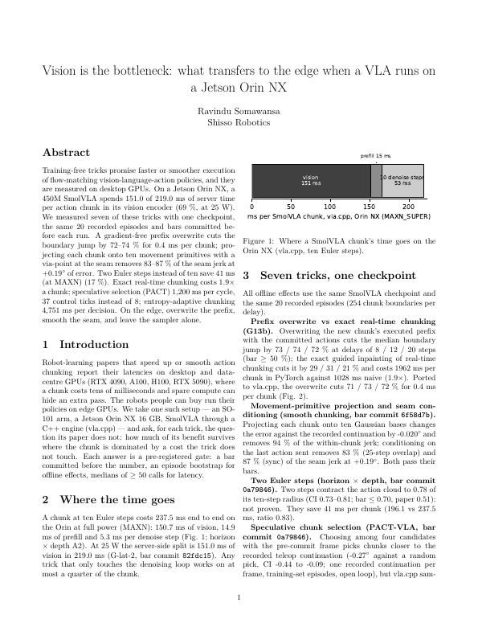
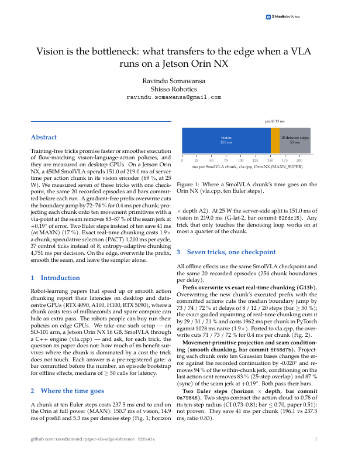
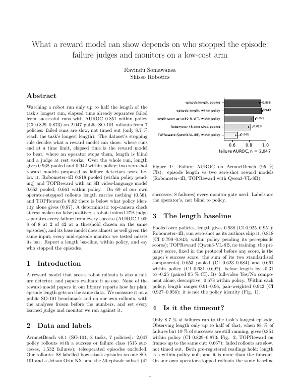
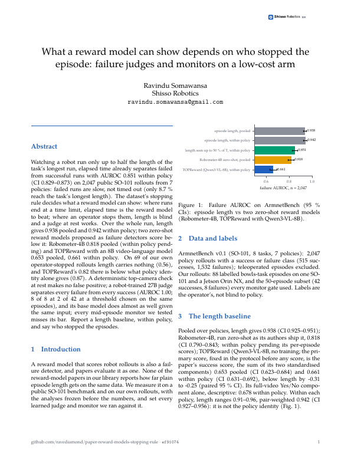
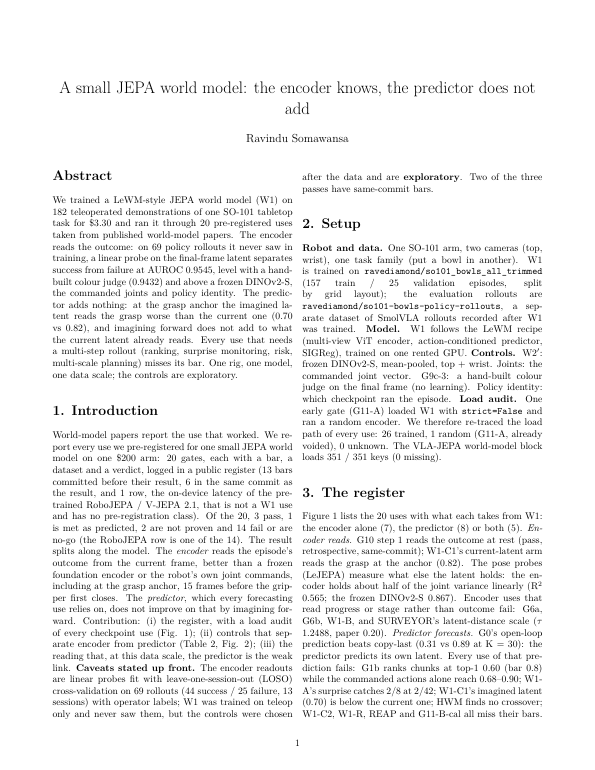
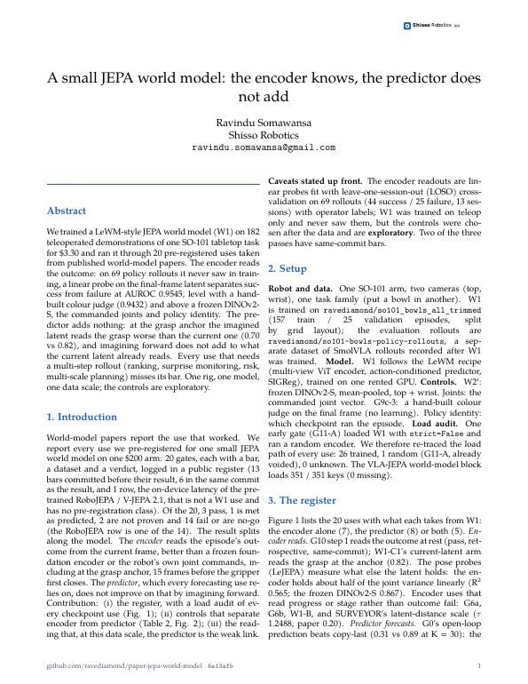
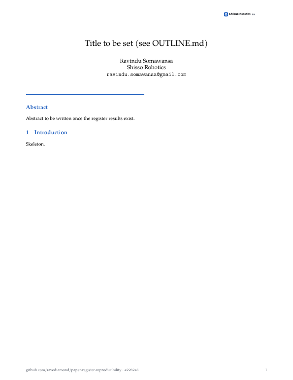

# Shisso house style (WS-132)

Light on purpose: a standard two-column paper with one accent colour (`#1F5FBF`, the site's `--accent`), a small wordmark top-right of page 1, a one-line footer (repo, build commit, page), Pagella text (TeX Gyre, embedded), accent section headings, accent table rules with a shaded header row. No boxes, icons or banner.

| file | what |
|---|---|
| `shisso.sty` | the package; loads after `\documentclass[10pt,twocolumn]{article}` (and `IEEEtran`; `hyperref` / `fancyhdr` clashes with a venue class are handled) |
| `shisso.mplstyle`, `shisso_colors.py` | figure style (7 pt, no top/right spines) and palette: accent + 4 Okabe-Ito hues, `GREY`, dashed `bar_line`, 20 % `band` |
| `logo/shisso_wordmark.{pdf,svg}`, `make_logo.py` | the wordmark (same mark as `site/public/assets/wordmark.svg`, 質素 in grey) |
| `screenshots/` | page 1 before / after for each paper |

## Use
```latex
\usepackage{style/shisso}            % after geometry/graphicx/hyperref/natbib
\shissorepo{github.com/ravediamond/<repo>}
\author{Ravindu Somawansa\\Shisso Robotics\\\texttt{ravindu.somawansa@gmail.com}}
```
Table header: `\toprule\shissohead A & B \\ \midrule …`. The commit in the footer comes from `paper/shisso_commit.tex`, written by `make pdf` (`git rev-parse --short HEAD`, untracked) so `main.tex` stays byte-stable for `make check`.
Figures: `import shisso_colors as sc; sc.use()` (path: `paper/style`); colours `sc.ACCENT`, `sc.CATEGORICAL`, `sc.GREY`; `sc.bar_line(ax, y)`; `sc.band(ax, x, lo, hi)`.
In a paper repo the folder is `paper/style/` with a `PROVENANCE.md`; edit here and re-copy.

## Checks (WS-132)
| check | result |
|---|---|
| deuteranopia (Machado 2009), min pairwise CIE76 ΔE of the 5 colours | 17.9 (`python3 shisso_colors.py`) |
| builds with tectonic | article, IEEEtran, and an article stub standing in for `neurips` / `icml` (those two class files are not in the offline tectonic bundle: **re-test when the venue file is in hand**) |
| `make check` | green in paper-vla-edge-inference, paper-reward-models-stopping-rule, paper-jepa-world-model; `numbers.json` and `DRAFT_4p.md` byte-identical to HEAD |

## Before / after (page 1)
| paper | before | after |
|---|---|---|
| vla-edge-inference |  |  |
| reward-models-stopping-rule |  |  |
| jepa-world-model |  |  |
| register (skeleton, no text yet) | — |  |

Page count (main.pdf, before → after): vla-edge-inference 2 → 3 (Pagella is wider than Computer Modern), reward-models 2 → 2, jepa-world-model 3 → 3.
